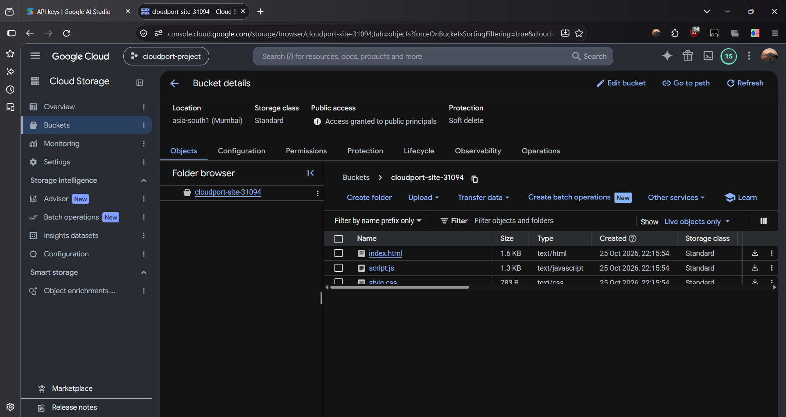
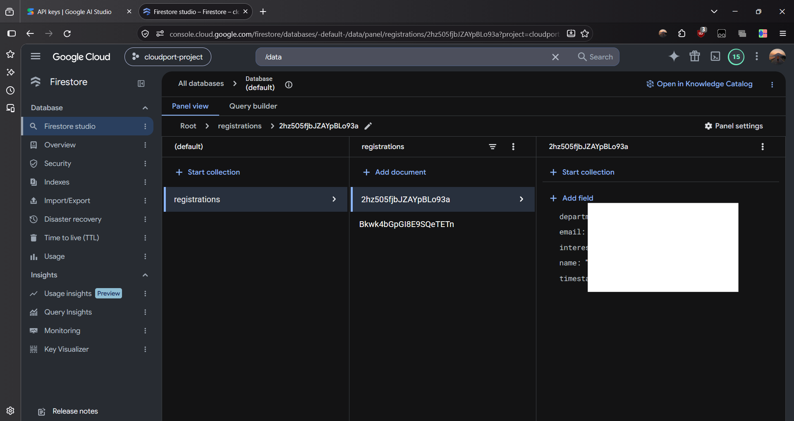

# CloudPort - Serverless Web App & Cloud Function Integration on GCP

CloudPort is a serverless event registration portal built on Google Cloud Platform (GCP). It connects a responsive HTML5/CSS3/JS web application hosted on **GCP Cloud Storage** to an HTTP-triggered **GCP Cloud Function** (Python runtime), which validates incoming request payloads and persists registration data into **Google Cloud Firestore** in real time.

---

## 🌐 Live Deliverable Endpoints

* **Live Website URL**: [https://storage.googleapis.com/cloudport-site-31094/index.html](https://storage.googleapis.com/cloudport-site-31094/index.html)
* **Live Cloud Function Endpoint**: [https://cloudport-backend-g2o2wbx2eq-el.a.run.app](https://cloudport-backend-g2o2wbx2eq-el.a.run.app)

---

## 🏗️ System Architecture & Data Flow

```mermaid
  ┌─────────────────────────────────────────────────────────────────────────┐
  │                            FRONTEND TIER                                │
  │  ┌───────────────────────────────────────────────────────────────────┐  │
  │  │                     GCP Cloud Storage Bucket                      │  │
  │  │                      (cloudport-site-31094)                       │  │
  │  │  ┌───────────────┐   ┌────────────────┐   ┌───────────────────┐   │  │
  │  │  │  index.html   │   │   style.css    │   │     script.js     │   │  │
  │  │  └───────────────┘   └────────────────┘   └─────────┬─────────┘   │  │
  │  └─────────────────────────────────────────────────────┼─────────────┘  │
  └────────────────────────────────────────────────────────┼────────────────┘
                                      │ HTTP POST (JSON Payload)
                                      ▼
  ┌─────────────────────────────────────────────────────────────────────────┐
  │                             BACKEND TIER                                │
  │  ┌───────────────────────────────────────────────────────────────────┐  │
  │  │                 GCP Cloud Function (Gen 2)                        │  │
  │  │                     (cloudport-backend)                           │  │
  │  │  • Runtime: Python 3.11                                           │  │
  │  │  • Region: asia-south1 (Mumbai)                                   │  │
  │  │  • Features: CORS Preflight, Field Validation,Exception Handler   │  │
  │  └─────────────────────────────────┬─────────────────────────────────┘  │
  └────────────────────────────────────┼────────────────────────────────────┘
                                       │ IAM Authenticated Write (ADC)
                                       ▼
  ┌─────────────────────────────────────────────────────────────────────────┐
  │                            DATABASE TIER                                │
  │  ┌───────────────────────────────────────────────────────────────────┐  │
  │  │                     Google Cloud Firestore                        │  │
  │  │                     Database: (default)                           │  │
  │  │  ┌─────────────────────────────────────────────────────────────┐  │  │
  │  │  │ Collection: "registrations"                                 │  │  │
  │  │  │ Document Fields:name, email, department,interest,timestamp  │  │  │
  │  │  └─────────────────────────────────────────────────────────────┘  │  │
  │  └───────────────────────────────────────────────────────────────────┘  │
  └─────────────────────────────────────────────────────────────────────────┘
```

### Data Flow Execution Steps
1. **Frontend Request**: The user submits form details (`name`, `email`, `department`, `interest`) via `index.html`.
2. **API Trigger**: `script.js` dispatches an asynchronous HTTP `POST` fetch request containing the JSON payload to the Cloud Function endpoint.
3. **Serverless Processing**: `cloudport-backend` handles CORS preflight (`OPTIONS`), validates for missing fields, and enforces backend integrity.
4. **Database Storage**: Validated entries are written as new documents into the `registrations` Firestore collection with a server-side timestamp (`SERVER_TIMESTAMP`).

---

## 📂 Project Repository Structure

```text
cloudport-gcp/
├── frontend/
│   ├── index.html          # Responsive HTML5 registration form
│   ├── style.css           # Custom CSS styling
│   └── script.js           # Fetch API client integration logic
├── backend/
│   ├── main.py             # Python HTTP Cloud Function handler with CORS & Firestore integration
│   └── requirements.txt    # Python dependencies (functions-framework, google-cloud-firestore)
├── screenshots/
│   ├── cloud-storage.png   # Console proof of active Cloud Storage bucket & static files
│   ├── cloud-function.png  # Console proof of active Cloud Function deployment
│   └── firestore-console.png # Console proof of live document records in Cloud Firestore
├── .gitignore              # Ignores sensitive keys, logs, and system files
├── architecture-diagram.png# Visual system architecture diagram
└── README.md               # Complete project setup & deployment documentation
```

---

## 🛠️ Tech Stack & Services Used

* **Hosting**: GCP Cloud Storage (Static Website Hosting)
* **Backend Compute**: GCP Cloud Functions (Gen 2, Python 3.11 Runtime)
* **Database**: Google Cloud Firestore (Native Mode)
* **Frontend**: HTML5, CSS3, JavaScript (Fetch API)
* **Security & IAM**: GCP Service Account Application Default Credentials (ADC), CORS Headers

---


## 🔒 Security & Best Practices

* **Zero Committed Credentials**: Uses Google Cloud's built-in Service Account Application Default Credentials (ADC). No secret JSON keys or API passwords are stored in source code.
* **CORS Handling**: `main.py` explicitly handles `OPTIONS` HTTP preflight requests with proper headers (`Access-Control-Allow-Origin: *`).
* **Input Validation**: Backend logic enforces strict field validation and rejects incomplete JSON requests with HTTP status `400 Bad Request`.

---

## 📸 GCP Console Deployment Proof Screenshots

### 1. Active Cloud Storage Bucket


### 2. Deployed GCP Cloud Function Overview


### 3. Live Records in Cloud Firestore Console


---

